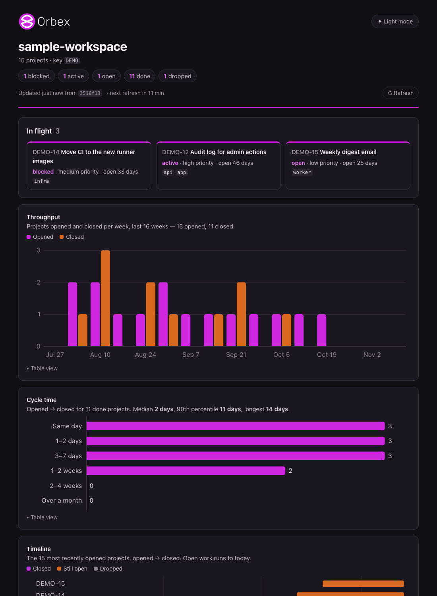

# orbex-dashboard

A live progress dashboard for an [Orbex](https://github.com/orbivision/orbex) workspace — an
**optional add-on**. Orbex already ships a static dashboard (`node scripts/dashboard.mjs --open`);
this is the same picture as a page you can leave open in a tab. It **refreshes itself every
10 minutes**.



It shows what the built-in dashboard shows: projects in flight, weekly throughput, cycle time, a
timeline, the inbox, memory due for review, the backlog and any problems in the plans. It also
tells you when your checkout is **behind `origin`**. Beyond that:

- **Capture** an idea from any page, straight into the workspace's inbox. See
  [Capturing ideas](#capturing-ideas).
- **Projects**: every project, filtered by status or repo and searchable, with each `plan.md`
  rendered in the page.
- **Host it** on Netlify behind a GitHub sign-in to use it from your phone. See
  [Hosting on Netlify](#hosting-on-netlify). Running it locally needs none of that.

## Setup

Clone it next to `orbex` and your workspace:

```
~/somewhere/
├── orbex/              # the machinery
├── my-workspace/       # your plans, memory, backlog
└── orbex-dashboard/    # this repo
```

```bash
git clone https://github.com/orbivision/orbex-dashboard.git
cd orbex-dashboard
npm install
npm run build
npm start -- --workspace ../my-workspace
```

Then open <http://127.0.0.1:4870/>. You need Node 22 or later, and the workspace needs to work
with Orbex already: `node scripts/next.mjs` runs inside it.

| Flag | |
|---|---|
| `--workspace <dir>` | The workspace to show. Or set `ORBEX_WORKSPACE`. |
| `--port <n>` | Default `4870`. |
| `--no-gh` | Skip the GitHub Issues inbox (offline, or `gh` not signed in). The page says "Not checked", not "empty". |
| `--no-fetch` | Don't `git fetch` for the behind-origin notice. |
| `--orbex <dir>` | Run the producers from this orbex clone instead of the workspace's `scripts/` link. Or set `ORBEX_HOME`. |

To try it without a workspace of your own, point it at orbex's sample:

```bash
npm start -- --workspace ../orbex/examples/sample-workspace --orbex ../orbex --no-gh
```

`npm run dev` runs the same server with Vite's hot reload, for working on the page itself.

## How it works

The server runs the workspace's own `scripts/next.mjs --json` and
`scripts/build-project-index.mjs --json`, the same two producers Orbex's built-in dashboard
renders. It adds a little git metadata and serves the result at `/api/snapshot`. The page draws
that data.

- **The page is never a source.** Status comes only from the producers' output, and nothing is
  stored: there's no database, no cache file and no saved snapshot. A dashboard that kept its own
  status would be a second list to keep in sync, and a second list drifts. To change what the
  page shows, change the plans, then wait for the next refresh or click **Refresh**. The Projects
  view displays a plan's text, but it derives nothing from it.
- **It makes one kind of write: Capture creates a new file under `inbox/`.** It never edits or
  deletes a file, and never touches `BACKLOG.md` or a plan.
- **Refreshing re-reads your local checkout.** It doesn't pull. Work committed on another
  machine shows up after you `git pull`, so the page tells you how far behind `origin` you are
  (from a read-only `git fetch`). It never changes your working tree.
- **Errors stay visible.** A failed producer, an unreadable inbox or a failed refresh is shown
  as an error. If a refresh fails, the page keeps the last good data and labels it stale.
- **Locally it listens on `127.0.0.1` only.** Plan titles are often private and local mode asks
  for no login, so it isn't exposed to the network. Because it can write, it also refuses
  requests whose `Host` isn't `127.0.0.1` or `localhost`, which stops DNS-rebinding pages.
- Results are cached in memory for 60 seconds, so several open tabs don't each run `gh`. Background
  tabs catch up as soon as you return to them, because browsers slow down timers in hidden tabs.
- `?refresh=<seconds>` in the URL shortens the interval (minimum 10 seconds), for testing.

**Versions.** The add-on depends on the producers' `--json` output, so the server checks the
fields it needs. If a change in orbex removes one, the page names the missing field instead of
drawing an empty chart. Update whichever repo is older.

## Capturing ideas

**＋ Capture** (in the side navigation, or on the Inbox card) takes a title and optional notes
and creates one file in the workspace:

```
inbox/2026-11-22T1830-the-one-line-idea.md
---
captured: 2026-11-22T18:30:42Z
source: dashboard
---

# The one-line idea

Optional notes.
```

The `inbox/` folder is orbex's own convention, the GitHub Issue's twin kept in git. `next.mjs`,
`/o-next` and the built-in dashboard list these files beside open issues. You triage a capture
the same way as an issue: move it into `BACKLOG.md` or a plan, then **delete the file**. GitHub
Issues still work for anyone who prefers them.

Each capture is a separate file, so two machines can never merge-conflict over the inbox. That
matters because a hosted capture is committed to `origin` while your laptop may be in the middle
of editing.

| | Where a capture goes |
|---|---|
| Local | Written to your working tree, **not committed**. Commit it with your other work (orbex's Stop hook reminds you). |
| Hosted | **Committed** to the workspace repo's branch through the GitHub API, as `inbox: <title>`. `git pull` to see it locally. |

This needs an orbex recent enough to read `inbox/`. With an older one the page says so instead
of hiding captures.

## Hosting on Netlify

Hosted mode reads the workspace **from GitHub**, not from a checkout. One GraphQL query fetches
only what the producers read (the marker, plans, `BACKLOG.md`, memory and `inbox/`). The real
producers then run on that copy, from an orbex pinned in `package.json` (`"orbex": { "ref" }`)
and vendored at build time. Hosted shows **what's pushed**: work you haven't committed and pushed
from a laptop isn't there.

Every path, including the JS bundle and `/api`, sits behind a GitHub sign-in checked against an
allowlist. An Edge Function enforces it, and the API checks it again. If sign-in is
misconfigured, everyone is refused, not everyone let in.

**1. A token to read and write the workspace repo.** Create a
[fine-grained personal access token](https://github.com/settings/personal-access-tokens/new)
with access to **only the workspace repository**. Give it **Contents: Read and write** (to read
plans and commit captures) and **Issues: Read-only** (for the inbox). Give it an expiry. Captures
are committed as the token's owner.

**2. A GitHub OAuth app for sign-in.** Create one under
[Developer settings → OAuth Apps](https://github.com/settings/developers). The callback URL is
`https://<your-site>/auth/callback`. Sign-in asks for no scopes. It only learns who you are, and
that token is discarded.

**3. A Netlify site** from your fork or clone of this repo. `netlify.toml` already has the build
settings. Set these environment variables in the Netlify UI:

| Variable | |
|---|---|
| `ORBEX_GITHUB_REPO` | `owner/name` of the workspace repo |
| `ORBEX_GITHUB_TOKEN` | the token from step 1 |
| `ORBEX_GITHUB_BRANCH` | optional, default: the repo's default branch |
| `ORBEX_WORKSPACE_PATH` | optional, if the workspace is a subdirectory of the repo |
| `ORBEX_OAUTH_CLIENT_ID`, `ORBEX_OAUTH_CLIENT_SECRET` | from step 2 |
| `ORBEX_SESSION_SECRET` | 32+ random characters (`openssl rand -base64 48`); changing it signs everyone out |
| `ORBEX_ALLOWED_USERS` | GitHub logins allowed in, comma-separated |

**One user today, more later.** A session carries an identity (provider, id, login), and the
allowlist is re-checked on every request. Adding someone means adding their login. Removing them
locks them out at once, without waiting for their cookie to expire. Per-user permissions would
hang off that identity. Nothing like that exists yet.

To try the hosted build locally, put test values in a gitignored `.env` and run
`npx netlify-cli dev --offline --dir dist` after `npm run build` and
`ORBEX_HOME=../orbex node scripts/fetch-orbex.mjs`.

## Development

```bash
npm test          # vitest: derivations, server, API + capture, auth, hosted source, and parity with orbex's dashboard.mjs
npm run typecheck
```

The parity test renders orbex's built-in dashboard for the sample workspace and checks that this
page computes the same numbers: throughput totals, cycle-time median, 90th percentile and
buckets, status counts. It's skipped if there's no `orbex` clone next to this one.

Stack: React, Vite, TypeScript and Tailwind CSS v4. The charts are drawn as SVG, without a
chart library. The API is Web-standard `Request` → `Response` handlers (`server/handlers.mjs`), run by
plain `node:http` locally and as Netlify Functions when hosted.

## License

MIT
